# Figma screen-state exports, 2026-11-09

**Source:** Figma export screenshots from `~/Downloads/Rusuh Tiket App-2/` (file `V1VQxA5Ckf82rMppnuMdSw`, "Rusuh-Tiket-App", mobile row), copied here on 2026-11-09.

**Naming:** `<group>-<NN>-<state>.png`. Each Figma mobile section is one 390pt-wide frame that stacks several states vertically, and each state was exported as its own PNG (about 2x, 785 px wide). Heights vary from 1693 px up to 4832 px.

**How the frames were sliced and read:** the Ticket Detail frame is section `60:2486`, Payment is `5:843`, Midtrans Snap is `54:1570`. Tall images were read at reduced size and zoomed on the areas that mattered. Text that could not be read is marked "(unreadable)". Money is shown as in the design (`Rp 2.180.000`).

| Group | Figma section | State | File |
| --- | --- | --- | --- |
| Ticket Detail | 60:2486 | Booking (60:2093) | `ticket-detail-01-booking.png` |
| Ticket Detail | 60:2486 | Profile without NIK (60:2241) | `ticket-detail-02-profile-without-nik.png` |
| Ticket Detail | 60:2486 | Booking time expired (60:2395) | `ticket-detail-03-booking-time-expired.png` |
| Payment | 5:843 | Choose method (5:490) | `payment-01-choose-method.png` |
| Payment | 5:843 | Virtual account (5:589) | `payment-02-virtual-account.png` |
| Payment | 5:843 | QRIS (5:662) | `payment-03-qris.png` |
| Payment | 5:843 | Verifying (5:741) | `payment-04-verifying.png` |
| Payment | 5:843 | Payment expired (5:790) | `payment-05-payment-expired.png` |
| Midtrans Snap | 54:1570 | Methods (54:1157) | `midtrans-snap-01-methods.png` |
| Midtrans Snap | 54:1570 | Order details (54:1272) | `midtrans-snap-02-order-details.png` |
| Midtrans Snap | 54:1570 | QRIS (54:1410) | `midtrans-snap-03-qris.png` |
| Midtrans Snap | 54:1570 | Popup closed (54:1516) | `midtrans-snap-04-popup-closed.png` |

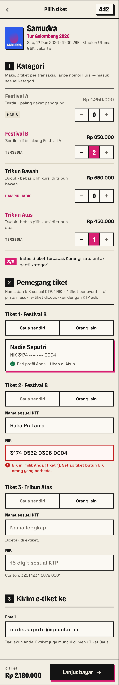 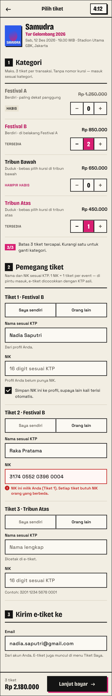 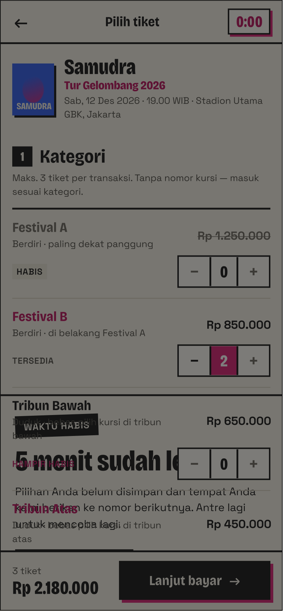
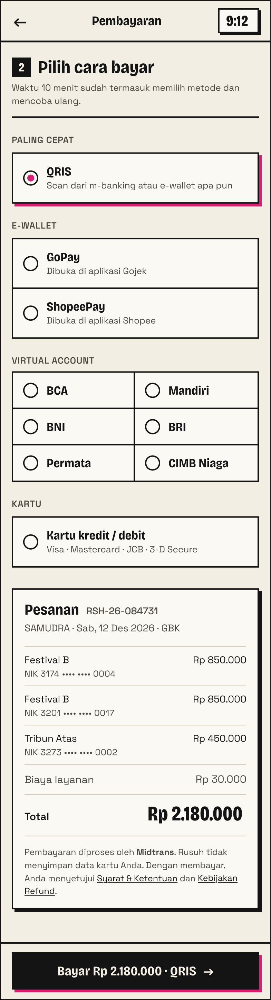 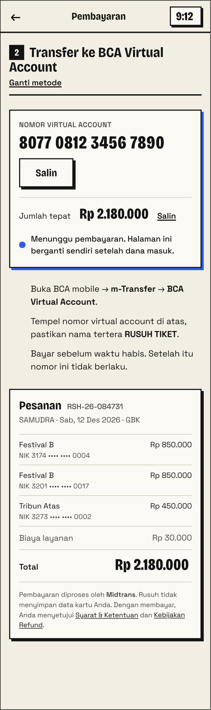 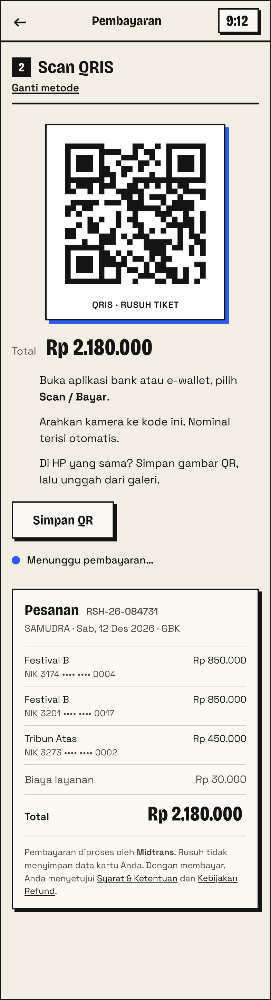 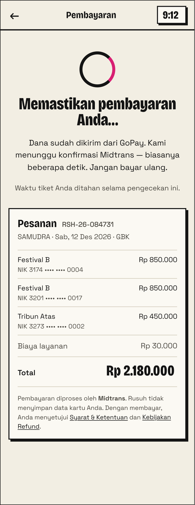 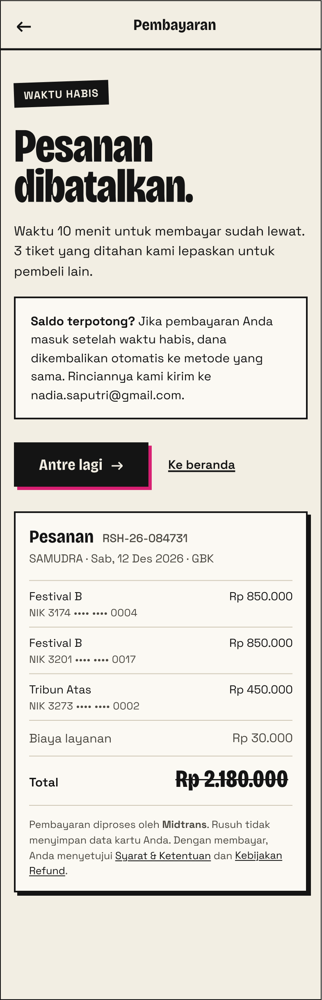
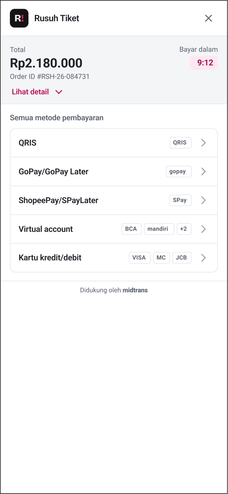 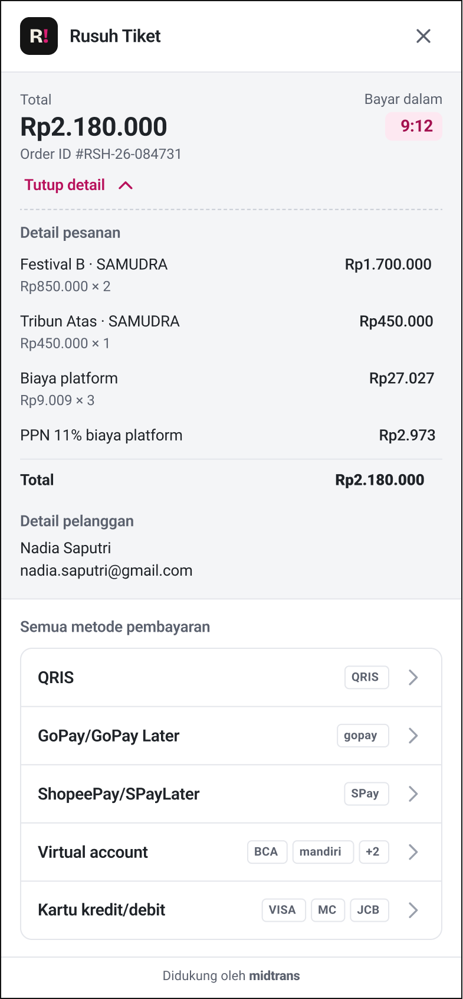 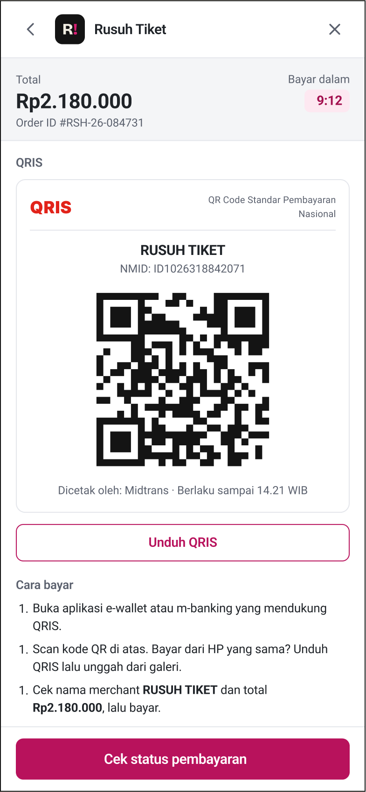 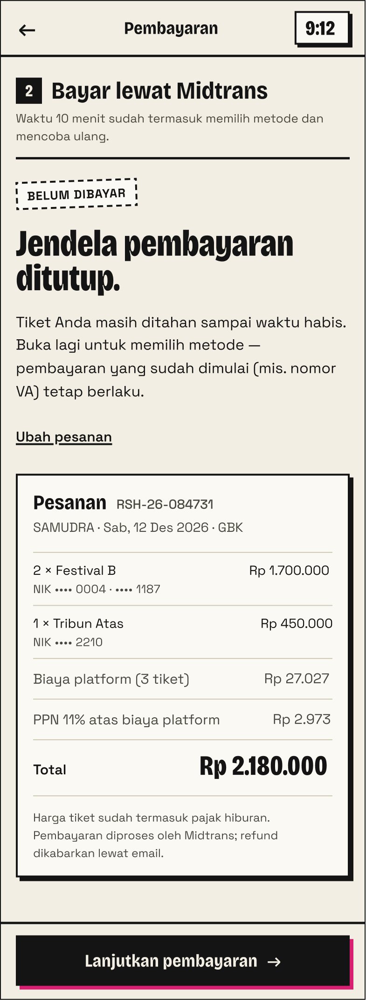

Shared design language: cream background, heavy black outlines with hard drop shadows (pink on primary actions, blue on payment instruction cards), black numbered section chips, a countdown chip at top right of the header, and a sticky bottom CTA bar. The Midtrans Snap frames use a different, plain white Material-like style (Midtrans' own page, branded "Rusuh Tiket" with an "R!" logo).

---

## 1. Ticket Detail (60:2486)

Shared header on all three states: back arrow, title `Pilih tiket`, countdown chip at right. Event header: poster thumbnail "SAMUDRA", `Samudra`, pink `Tur Gelombang 2026`, `Sab, 12 Des 2026 · 19.00 WIB · Stadion Utama GBK, Jakarta`.

### 1.1 Booking

**Purpose / trigger:** buyer admitted from the waiting room, within the 5 minute order window. Pick categories (max 3 tickets), enter a holder name and NIK per ticket, and confirm the e-ticket email. This state shows a filled-in form that includes a validation error.

**Structure, top to bottom**

| Block | Content as shown |
| --- | --- |
| Header | `Pilih tiket`, chip `4:12` |
| Section 1 `Kategori` | Hint: `Maks. 3 tiket per transaksi. Tanpa nomor kursi — masuk sesuai kategori.` |
| Festival A | `Berdiri · paling dekat panggung`, price struck through `Rp 1.250.000`, badge `HABIS`, stepper `− 0 +` |
| Festival B | pink name, `Berdiri · di belakang Festival A`, `Rp 850.000`, label `TERSEDIA`, stepper at `2` (pink centre) |
| Tribun Bawah | `Duduk · bebas pilih kursi di tribun bawah`, `Rp 650.000`, pink label `HAMPIR HABIS`, stepper at `0` |
| Tribun Atas | pink name, `Duduk · bebas pilih kursi di tribun atas`, `Rp 450.000`, `TERSEDIA`, stepper at `1` |
| Cap row | pink chip `3/3` + `Batas 3 tiket tercapai. Kurangi satu untuk ganti kategori.` |
| Section 2 `Pemegang tiket` | `Nama dan NIK sesuai KTP. 1 NIK = 1 tiket per event — di pintu masuk, e-tiket dicocokkan dengan KTP asli.` |
| Tiket 1 · Festival B | segmented `Saya sendiri` (selected) / `Orang lain`. Card (pink shadow): `Nadia Saputri`, `NIK 3174 •••• •••• 0004`, green check `Dari profil Anda` · link `Ubah di Akun` |
| Tiket 2 · Festival B | segmented `Orang lain` selected. `Nama sesuai KTP` = `Raka Pratama`. `NIK` = `3174 0552 0396 0004` in a red-bordered field |
| Tiket 3 · Tribun Atas | `Orang lain` selected, both fields empty. Placeholders `Nama lengkap` (help `Dicetak di e-tiket.`) and `16 digit sesuai KTP` (help `Contoh: 3201 1234 5678 0001`) |
| Section 3 `Kirim e-tiket ke` | `Email` = `nadia.saputri@example.com`, help `Dari akun Anda. E-tiket juga muncul di menu Tiket Saya.` |
| Sticky bar | `3 tiket`, `Rp 2.180.000`, black button `Lanjut bayar →` |

**Control states:** category steppers are minus / count / plus, with a pink centre when count > 0. `Habis` row is greyed. Segmented toggle: selected side has bold text, the other is grey. Own-NIK holder shows a read-only card instead of fields. `+` buttons look the same in the cap state (disabled styling not visible, unclear).

**Order summary box:** none on this screen. Only the sticky bar total `Rp 2.180.000` (2 x 850.000 + 450.000 = 2.150.000, plus 30.000 fee = 2.180.000; the fee is not itemised here).

**Validation / error:** `NIK ini milik Anda (Tiket 1). Setiap tiket butuh NIK orang yang berbeda.` (red, with an alert icon) on Tiket 2.

**Implementation notes**
- Slots follow the total quantity (one block per ticket), and the label includes the category (`Tiket 3 · Tribun Atas`).
- Duplicate-NIK check is client-side across tickets of the same order, and must also cover "mine" vs "other". The server rule is one NIK per event (ADR-0007), so the server error for NIK already used elsewhere needs its own copy (not shown in Figma).
- The default for ticket 1 is `Saya sendiri` with data "from the profile". See section 4: our account has no NIK.
- Email is prefilled from the account and shown read-only-looking (editability unclear).
- Timer must be driven by server `expiresAt − serverNow`, not the device clock (ADR-0005).

### 1.2 Profile without NIK

**Purpose / trigger:** same screen as 1.1, but the logged-in account has a name and no NIK on file. Same header, categories (Festival B x2, Tribun Atas x1), `3/3` cap row, Tiket 2 duplicate NIK error, Tiket 3 empty, email and sticky bar (`3 tiket`, `Rp 2.180.000`) as in 1.1. Only Tiket 1 differs.

**Tiket 1 · Festival B (differs)**

| Element | Content |
| --- | --- |
| Segmented | `Saya sendiri` selected |
| `Nama sesuai KTP` | `Nadia Saputri` (filled), help `Dari profil Anda.` |
| `NIK` | empty, placeholder `16 digit sesuai KTP` |
| Help | `Profil Anda belum punya NIK.` |
| Checkbox (checked) | `Simpan NIK ini ke profil, supaya lain kali terisi otomatis.` |

**Implementation notes**
- The checkbox is checked by default in the design and is the "save NIK to profile" control.
- It needs a profile NIK endpoint. Per our decision the account has no NIK, so this control and the card in 1.1 must be dropped or changed (section 4).
- Rest of the screen is identical, so one composable with a ticket-1 variation covers both.

### 1.3 Booking time expired

**Purpose / trigger:** the 5 minute order window ended. A dimmed overlay covers the Booking screen.

**Structure**
- Header chip is `0:00` in pink. The screen behind is dimmed (grey scrim), showing `Festival A` (`HABIS`), `Festival B` (2), then Tribun Bawah and Tribun Atas rows with the sticky bar `3 tiket` / `Rp 2.180.000` / `Lanjut bayar →` (all still visible, dimmed).
- Overlay content: black tilted badge `WAKTU HABIS`, big heading starting `5 menit sudah le…` (rest overlaps the dimmed rows, presumably "lewat"), body `Pilihan Anda belum disimpan dan tempat Anda kembali ke nomor berikutnya. Antre lagi untuk mencoba lagi.` (some words are overlapped by the dimmed rows below, so the wording around `kembali ke nomor berikutnya` is partly unreadable).
- Primary button / action row (e.g. `Antre lagi`): (unreadable). The export looks cropped or the overlay layers are overlapping, so the bottom sheet's buttons are not visible.

**Implementation notes**
- The design treats expiry as a modal over the form. Our code uses a full-screen `ExpiredState` (section 4).
- Overlapping text suggests a layout bug in the Figma frame. Ask design for a clean export.
- The flow of the CTA (back into the queue at the back, ADR-0005) should be confirmed with the visible button label.

---

## 2. Payment (5:843)

Shared header on states 1 to 4: back arrow, title `Pembayaran`, timer chip `9:12` (the 10 minute payment window). State 5 has no chip. All Payment frames show the same order summary box (listed once below, then referenced).

**Order summary box (identical in states 1 to 5, "Pesanan")**

| Line | Value |
| --- | --- |
| Title | `Pesanan` + `RSH-26-084731`, sub `SAMUDRA · Sab, 12 Des 2026 · GBK` |
| Festival B | `Rp 850.000`, `NIK 3174 •••• •••• 0004` |
| Festival B | `Rp 850.000`, `NIK 3201 •••• •••• 0017` |
| Tribun Atas | `Rp 450.000`, `NIK 3273 •••• •••• 0002` |
| `Biaya layanan` | `Rp 30.000` (single line, no tax line) |
| `Total` | `Rp 2.180.000` (struck through in state 5) |
| Footer | `Pembayaran diproses oleh Midtrans. Rusuh tidak menyimpan data kartu Anda. Dengan membayar, Anda menyetujui Syarat & Ketentuan dan Kebijakan Refund.` (links underlined) |

Note the NIKs here (3174…0004, 3201…0017, 3273…0002) differ from the Ticket Detail frames (3174…0004 twice). They are separate sample data.

### 2.1 Choose method

**Purpose / trigger:** buyer pressed `Lanjut bayar` and the hold started (10 minute window).

**Structure**
- Header `Pembayaran`, chip `9:12`.
- Section chip `2` + `Pilih cara bayar`, hint `Waktu 10 menit sudah termasuk memilih metode dan mencoba ulang.`
- Group `PALING CEPAT`: `QRIS` (`Scan dari m-banking atau e-wallet apa pun`), radio selected (pink dot), pink shadow.
- Group `E-WALLET`: `GoPay` (`Dibuka di aplikasi Gojek`), `ShopeePay` (`Dibuka di aplikasi Shopee`).
- Group `VIRTUAL ACCOUNT`: 2-column grid `BCA`, `Mandiri`, `BNI`, `BRI`, `Permata`, `CIMB Niaga`.
- Group `KARTU`: `Kartu kredit / debit` (`Visa · Mastercard · JCB · 3-D Secure`).
- Order summary box (above).
- Sticky button `Bayar Rp 2.180.000 · QRIS →` (label follows the selected method).

**Control states:** single-select radio list; QRIS preselected; the CTA label includes the method.

**Implementation notes**
- This is our own method picker. ADR-0008 says the method is chosen on the Midtrans Snap page, so this screen has no equivalent in the target design (section 4).
- If kept as a pre-selection it must map to a Snap method and cannot change what Snap shows (unclear).
- The 10 minute hint copy is reusable on the handoff screen (see Snap 04).

### 2.2 Virtual account

**Purpose / trigger:** BCA chosen. Shows the VA instructions inside the app.

**Structure**
- Chip `9:12`. Heading `2  Transfer ke BCA Virtual Account`, link `Ganti metode`.
- Blue-shadow card: label `NOMOR VIRTUAL ACCOUNT`, number `8077 0812 3456 7890`, button `Salin`; `Jumlah tepat` `Rp 2.180.000` with link `Salin`; blue dot + `Menunggu pembayaran. Halaman ini berganti sendiri setelah dana masuk.`
- Instructions: `Buka BCA mobile → m-Transfer → BCA Virtual Account.` / `Tempel nomor virtual account di atas, pastikan nama tertera RUSUH TIKET.` / `Bayar sebelum waktu habis. Setelah itu nomor ini tidak berlaku.`
- Order summary box. No sticky CTA.

**Implementation notes**
- Page auto-advances when the payment arrives (poll or push), so no manual check button. Snap QRIS has one (`Cek status pembayaran`).
- Copy buttons need clipboard + feedback.
- Under ADR-0008 the VA number would be shown by Snap, not by us.

### 2.3 QRIS

**Purpose / trigger:** QRIS chosen.

**Structure**
- Chip `9:12`. Heading `2  Scan QRIS`, link `Ganti metode`.
- QR card (blue shadow) with a QR image captioned `QRIS · RUSUH TIKET`.
- `Total` `Rp 2.180.000`.
- Instructions: `Buka aplikasi bank atau e-wallet, pilih Scan / Bayar.` / `Arahkan kamera ke kode ini. Nominal terisi otomatis.` / `Di HP yang sama? Simpan gambar QR, lalu unggah dari galeri.`
- Button `Simpan QR`. Status: blue dot `Menunggu pembayaran...`
- Order summary box. No sticky CTA.

**Implementation notes**
- `Simpan QR` needs media-store permission on Android and photo-library add on iOS.
- QR expiry time is not shown here (Snap QRIS shows `Berlaku sampai 14.21 WIB`).

### 2.4 Verifying

**Purpose / trigger:** funds were sent, awaiting Midtrans confirmation (late webhook window).

**Structure**
- Chip `9:12`. Spinner ring (black with pink arc).
- Heading `Memastikan pembayaran Anda...`
- Body `Dana sudah dikirim dari GoPay. Kami menunggu konfirmasi Midtrans — biasanya beberapa detik. Jangan bayar ulang.`
- Note `Waktu tiket Anda ditahan selama pengecekan ini.`
- Order summary box. No buttons.

**Implementation notes**
- This is the state to show after returning from Snap while the booking is still `awaiting payment` or the payment is `pending`. The app must re-fetch the booking and never trust the return URL (ADR-0008).
- Copy names GoPay, so the wallet name must come from the payment data (or be generic if Snap does not give it).
- Needs a timeout behaviour that is not shown (what if confirmation never comes?).
- Matches the "paid always means issued" principle: do not release the hold while verifying.

### 2.5 Payment expired

**Purpose / trigger:** the 10 minute payment window elapsed without confirmed payment.

**Structure**
- Header `Pembayaran` (no timer chip).
- Black tilted badge `WAKTU HABIS`. Heading `Pesanan dibatalkan.`
- Body `Waktu 10 menit untuk membayar sudah lewat. 3 tiket yang ditahan kami lepaskan untuk pembeli lain.`
- Outlined box: `Saldo terpotong? Jika pembayaran Anda masuk setelah waktu habis, dana dikembalikan otomatis ke metode yang sama. Rinciannya kami kirim ke nadia.saputri@example.com.`
- Buttons: black `Antre lagi →` (pink shadow) and text link `Ke beranda`.
- Order summary box with total struck through.

**Implementation notes**
- The late-payment refund text matches ADR-0009 (late payment flagged, refunded).
- `Antre lagi` re-joins the back of the queue (ADR-0005). `Ke beranda` goes to Home.
- Email in the copy is the account email.

---

## 3. Midtrans Snap (54:1570)

These four frames depict Midtrans' own hosted page (white, Roboto-like, "Rusuh Tiket" brand header with a close `×`), plus our in-app screen shown when the Snap tab is closed. Per ADR-0008 the app opens Snap in a system tab (Custom Tabs / SFSafariViewController) and returns via App Link.

### 3.1 Methods

**Purpose / trigger:** Snap landing page after the handoff.

**Structure**
- Header: `R!` logo, `Rusuh Tiket`, close `×`.
- Grey summary band: `Total` `Rp2.180.000`, `Order ID #RSH-26-084731`, `Bayar dalam` pink chip `9:12`, link `Lihat detail ⌄`.
- `Semua metode pembayaran` list (each with a chevron): `QRIS` (tag `QRIS`), `GoPay/GoPay Later` (`gopay`), `ShopeePay/SPayLater` (`SPay`), `Virtual account` (`BCA`, `mandiri`, `+2`), `Kartu kredit/debit` (`VISA`, `MC`, `JCB`).
- Footer `Didukung oleh midtrans`. Rest of the screen is empty white.

**Implementation notes**
- This list is controlled by Midtrans config (enabled payments), not by our app.
- Snap's timer should equal our payment window (server `expiresAt`), so the hold and Snap expiry must be set consistently (open question).

### 3.2 Order details

**Purpose / trigger:** `Lihat detail` expanded (link becomes `Tutup detail ⌃`).

**Order details block**

| Line | Value |
| --- | --- |
| `Detail pesanan` | |
| Festival B · SAMUDRA | `Rp1.700.000` (`Rp850.000 × 2`) |
| Tribun Atas · SAMUDRA | `Rp450.000` (`Rp450.000 × 1`) |
| Biaya platform | `Rp27.027` (`Rp9.009 × 3`) |
| PPN 11% biaya platform | `Rp2.973` |
| Total | `Rp2.180.000` |
| `Detail pelanggan` | `Nadia Saputri`, `nadia.saputri@example.com` |

Then the same method list as 3.1.

**Implementation notes**
- Item lines come from the Snap `item_details`, customer from `customer_details`. Keep totals equal to the booking total to the rupiah (27.027 + 2.973 = 30.000).
- The platform fee here is `Rp9.009 × 3` (per ticket, tax 11% split out), but ADR-0010 says a fixed fee per order. See section 4.

### 3.3 QRIS

**Purpose / trigger:** QRIS selected on Snap.

**Structure**
- Header with back chevron `<`, logo, `Rusuh Tiket`, close `×`. Summary band (`Rp2.180.000`, `Order ID #RSH-26-084731`, `Bayar dalam` `9:12`).
- Section `QRIS`; card: red `QRIS` logo, `QR Code Standar Pembayaran Nasional`, `RUSUH TIKET`, `NMID: ID1026318842071`, QR image, `Dicetak oleh: Midtrans · Berlaku sampai 14.21 WIB`.
- Outlined button `Unduh QRIS`.
- `Cara bayar`: `Buka aplikasi e-wallet atau m-banking yang mendukung QRIS.` / `Scan kode QR di atas. Bayar dari HP yang sama? Unduh QRIS lalu unggah dari galeri.` / `Cek nama merchant RUSUH TIKET dan total Rp2.180.000, lalu bayar.` (all three numbered "1." in the export).
- Pink filled button `Cek status pembayaran`.

**Implementation notes**
- This is Midtrans' page, so only the system tab around it is ours. The NMID is sample data.
- `Cek status pembayaran` closes or redirects back to the app through the finish URL (App Link).

### 3.4 Popup closed

**Purpose / trigger:** the user closed the Snap tab before paying. This is an in-app screen (our style), not a Snap page.

**Structure**
- Header `Pembayaran`, chip `9:12`. Section `2  Bayar lewat Midtrans`, hint `Waktu 10 menit sudah termasuk memilih metode dan mencoba ulang.`
- Dashed tag `BELUM DIBAYAR`. Heading `Jendela pembayaran ditutup.`
- Body `Tiket Anda masih ditahan sampai waktu habis. Buka lagi untuk memilih metode — pembayaran yang sudah dimulai (mis. nomor VA) tetap berlaku.`
- Link `Ubah pesanan`.
- Order summary box (differs from section 2): `2 × Festival B` `Rp 1.700.000` (`NIK •••• 0004 · •••• 1187`), `1 × Tribun Atas` `Rp 450.000` (`NIK •••• 2210`), `Biaya platform (3 tiket)` `Rp 27.027`, `PPN 11% atas biaya platform` `Rp 2.973`, `Total` `Rp 2.180.000`; footer `Harga tiket sudah termasuk pajak hiburan. Pembayaran diproses oleh Midtrans; refund dikabarkan lewat email.`
- Sticky button `Lanjutkan pembayaran →`.

**Implementation notes**
- Resume reopens Snap with a fresh one-time handoff code (ADR-0008) while the hold lasts.
- `Ubah pesanan` goes back to Ticket Detail. What happens to the hold is not defined (open question).
- This is the intended in-app payment screen and its summary box is the newer, tax-itemised version.

---

## 4. Differences vs what we built / decisions

Compared with the merged Detail screen on `rusuh-app` `main` (PR #58: `DetailScreen.kt`, `AttendeeSection.kt`, `DetailContract.kt`, `SeatCategoryCard.kt`). An earlier draft of this section compared against a stale local checkout and was wrong; it was corrected on 2026-11-09 against `origin/main`.

### 4.1 NIK on profile / account (conflicts with the decision)

| Figma | Conflict | Proposed handling |
| --- | --- | --- |
| Ticket Detail 1.1: `Saya sendiri` card shows `NIK 3174 •••• •••• 0004`, `Dari profil Anda · Ubah di Akun` | Assumes the account stores a NIK | Do not prefill a NIK. `Saya sendiri` can prefill only the name, with a NIK field to type |
| Ticket Detail 1.2 "Profile without NIK" state | Only exists because accounts may have a NIK. In our implementation every account is "without NIK", so this is the only state that applies, and 1.1's own-card variant is never reachable | Treat 1.2 as the default Tiket 1 layout, minus the checkbox |
| 1.2 checkbox `Simpan NIK ini ke profil, supaya lain kali terisi otomatis.` and help `Profil Anda belum punya NIK.` | Saves NIK to the profile, which our account has no place for, and that endpoint does not exist | Drop the checkbox and the help text |
| 1.1 link `Ubah di Akun` | Account screen (Figma `60:3128`) has `Edit name & NIK` and `No NIK yet` states, also in conflict | Flag for the Account slice |
| Account section in Figma (60:2910, 60:3021) | Not exported here, but referenced by the above | Human decision needed |

### 4.2 Own VA / QRIS screens vs Midtrans Snap (ADR-0008)

- Payment frames 02 (VA) and 03 (QRIS) and the in-app method picker 01 build payment UIs that Midtrans Snap already provides. ADR-0008 says to open Snap in a system tab, so those three are redundant for the real flow and would require Core API charge calls.
- Snap frames 01 to 03 are the Midtrans-owned replacements for Payment 01 to 03. We cannot restyle them. They show what the user will see (and what our order data must look like).
- What remains ours:

| Our screen | Frame | Role |
| --- | --- | --- |
| Handoff / resume | Snap 04 `Bayar lewat Midtrans` | Before opening Snap, and after the tab is closed unpaid |
| Verifying | Payment 04 | After return, waiting for confirmation |
| Expired | Payment 05 | 10 minute window over |

- Payment 01 to 03 (own picker, VA, QRIS) should be ignored or kept only as reference. Payment 04 and 05 stay valid. Snap 04 replaces Payment 01 as the entry point.
- The first handoff state (before the tab opens) is not in the Figma set, and the success state is not either (it lives in E-ticket 5:1013).

### 4.3 Layout differences vs the merged Detail screen (PR #58)

The merged screen was built from the Figma Booking state and already matches most of it: header with back arrow and countdown chip, event header, numbered section chips (`1 Kategori`, `2 Pemegang tiket`, `3 Kirim e-tiket ke`), `Saya sendiri` / `Orang lain` toggle, name and NIK per ticket (NIK masked when not focused), duplicate-NIK error, `3/3` cap row, e-ticket email block, sticky bar with the total including ONE admin fee per order, and a modal-style expired state.

| Area | Figma (new exports) | Merged code | Action |
| --- | --- | --- | --- |
| `Saya sendiri` for ticket 1 | read-only card `NIK 3174 •••• •••• 0004` + `Dari profil Anda · Ubah di Akun` (1.1), or name prefilled + help `Dari profil Anda.` / `Profil Anda belum punya NIK.` + checkbox `Simpan NIK ini ke profil` (1.2) | `Self` prefills the name only, NIK always typed, no checkbox, no profile hint texts | Decision needed (see 4.1). Layout of 1.2 minus the checkbox is the closest match; add the `Dari profil Anda.` name help if wanted |
| Expired state | dimmed full booking form behind a modal `WAKTU HABIS`, `0:00` chip; buttons unreadable in the export | header-only backdrop (form not composed on purpose: no PII behind the scrim, nothing focusable) + overlay sheet | Keep ours; ask design for a clean export of the expired frame |
| Payment screens | five own screens (picker, VA, QRIS, verifying, expired) + Snap frames | none built yet | New slices, see `06-next-ticket-slices-draft.md` section 7 |
| Waiting Room top bar | back, `Ruang tunggu`, ID/EN pill | back and title, no pill | Follow-up slice (Waiting Room visual pass) |

### 4.4 Fees and timers

- **Platform fee:** the Snap frames show `Biaya platform Rp9.009 × 3` + `PPN 11% biaya platform Rp2.973` (together Rp30.000). ADR-0010 says a fixed amount per order, shown as `Biaya layanan`. The Payment frames use a single `Biaya layanan Rp 30.000`. The Snap and Snap-04 breakdown looks per ticket, which conflicts with ADR-0010. Rp30.000 is the same in every frame.
- **Timer:** the Detail chip (`4:12`) is within 5 minutes and the payment chips (`9:12`) within 10 minutes, as in ADR-0005. Snap shows the same `9:12`.
- **Entertainment tax:** Snap-04 footer says `Harga tiket sudah termasuk pajak hiburan`.

### 4.5 Open questions for a human

1. Is `Saya sendiri` still offered if the account has no NIK? Should it prefill only the name and offer no profile save?
2. Do we drop Payment 01 to 03 from the build scope entirely and keep only 04, 05 and Snap 04 as app screens?
3. Fee model: per order (ADR-0010, Rp30.000 as `Biaya layanan`) or per ticket with tax (`Rp9.009 × 3` + PPN 11%)? Which one does the backend return?
4. Which payment methods does the Snap config enable? Figma lists QRIS, GoPay, ShopeePay, VA (BCA, Mandiri, +2) and cards.
5. Expired Detail frame: what are the button label(s) in the overlay (unreadable in the export), and is it a modal or a full screen?
6. What does `Ubah pesanan` (Snap 04) do to the active hold?
7. Is there a timeout / failure copy for the Verifying state? Not designed.
8. Does the e-ticket email field stay editable, or is it always the account email?
9. Should Figma be updated so the sample NIKs are consistent across Detail and Payment frames (they differ)?
